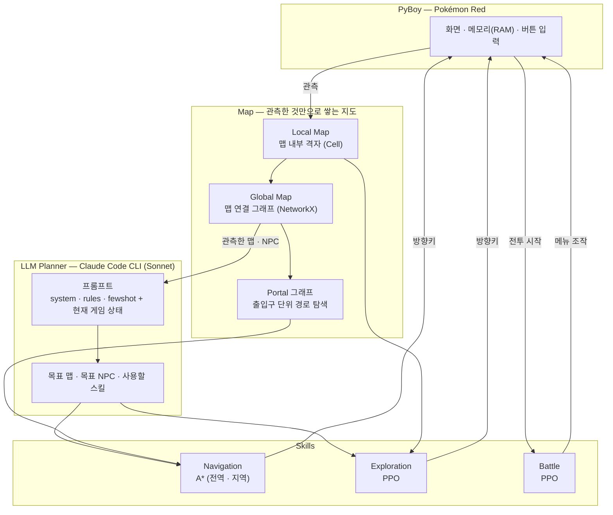
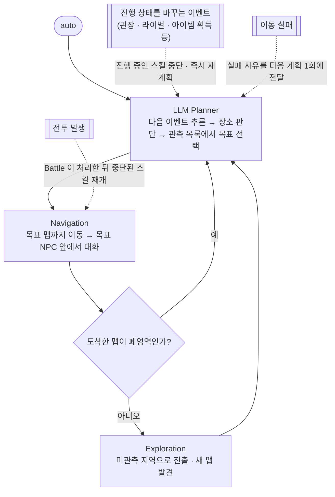

# 장기계획 문제를 위한 스킬 기반 Pokémon-Playing Agent

> LLM 플래너와 하위 스킬(Navigation · Exploration · Battle)을 결합해, 사람의 개입 없이 'Pokémon Red' 를 진행하는 계층형 에이전트
>
> 2026 전기 부산대학교 정보컴퓨터공학부 졸업과제 · 22조 **Red-Y** · 지도교수 김원석
>
> [시연 영상](https://www.youtube.com/watch?v=6qUmOWHkJos) · [최종보고서](docs/01.보고서/3.2026전기_최종보고서_22_Red-Y_장기계획%20문제를%20위한%20스킬%20기반%20Pokémon-Playing%20Agent.pdf) · [포스터](docs/02.포스터/2026포스터_22_Red-Y_01085361597.pdf) · [발표자료](docs/03.발표자료/발표자료.pdf)

---

## 1. 프로젝트 배경

### 1.1. 국내외 시장 현황 및 문제점

**피지컬 AI 의 부상** — 인공지능은 단일 작업을 수행하는 모델을 넘어, 환경을 인식하고 상황을 판단해 장기적인 목표를
수행하는 방향으로 발전하고 있으며, 가상 공간을 벗어나 실제 세계에서 인지·판단·행동하는 **피지컬 AI** 로 이어지고 있다.
NVIDIA 젠슨 황 CEO 가 CES 2025 기조연설에서 피지컬 AI 를 제시한 이후 산업계와 학계의 핵심 키워드로 떠올랐다.

| 시장 | 규모 | 출처 |
|---|---|---|
| 전 세계 AI 로봇 시장 | 약 320억 달러(2020) → 약 710억 달러(2025) → 약 1,290억 달러(2030) → 약 1,610억 달러(2032, 전망) | Statista [1] |
| 피지컬 AI 시장 | 약 51억 달러(2025) → 약 349억 달러(2031, 전망) · 연평균 37.5% 성장 | Mordor Intelligence [2] |

**학습 환경의 문제** — 강화학습 기반 로봇 정책은 수백만 회 이상의 시행착오가 필요하다. 실제 환경에서만 학습하면
시간·비용·장비 마모·안전 위험이 크기 때문에, 시뮬레이션에서 학습한 뒤 실제 로봇으로 옮기는 **sim-to-real** 방식이
대안으로 자리 잡고 있다. 또한 로봇의 실제 작업은 "물건을 주워 옮기기"(Move → Align → Grasp → Release)처럼 여러 하위
스킬을 선행 조건에 따라 이어야 하는 **장기 복합 과제**인 경우가 많다.

**기존 게임 에이전트의 한계** — 'Pokémon Red' 를 강화학습으로 푼 대표 연구는 PufferLib 기반의 **단일 에이전트**
방식으로, PPO 에이전트가 첫 체육관을 넘어 갈색시티까지 도달했고 [3], 이후 1,000만 개 미만 파라미터의 정책으로
게임 클리어를 보고했으나 일부 구간은 스크립트로 대체했다 [4]. 이 방식에는 두 가지 한계가 있다.

1. **복합 과제** — 갈색시티 체육관은 풀베기 나무로 막혀 있다. 들어가려면 비전머신을 얻고, 메뉴로 기술을 가르치고,
   나무 앞에서 사용해야 한다. 이 행동들은 그전까지 한 번도 필요하지 않아 보상으로 배울 기회가 없었고, 결국 스크립트로 처리했다.
2. **희소 이벤트** — 잠든 잠만보를 포켓몬 피리로 깨우는 것처럼 진행에 필수지만 드문 이벤트는, 이벤트마다 보상을
   설계하고 다시 학습해야 해 비효율적이다.

### 1.2. 필요성과 기대효과

장기 복합 과제의 구조는 '포켓몬스터' 게임에서도 그대로 나타난다. 게임을 진행하려면 맵 탐색, 전투, NPC 상호작용처럼
성격이 전혀 다른 기술을 번갈아 써야 하고, 특정 배지나 기술을 얻어야 새 지역으로 갈 수 있어 **행동의 가능 여부가 선행
조건에 달려 있다**. 이는 로봇이 선행 조건을 만족시키며 여러 기술을 조합해 장기 목표를 이루는 과정과 구조적으로 대응된다.
동시에 에뮬레이터로 **빠르고 안전하게 반복 실험**할 수 있어, 실제 로봇 실험에 앞서 계층형 의사결정 구조를 검증하는
시뮬레이션 환경으로 적합하다.

기대효과

- 상위 목표 판단(LLM Planner)과 하위 실행(Skills)을 분리하고 둘을 **관측한 정보만으로** 연결한 구조를 실제로 동작하는 형태로 제시한다.
- 상위 계층은 하위 스킬의 구현을 알 필요가 없고 하위 스킬은 전체 진행 맥락을 알 필요가 없어, **하위 스킬만 바꾸면 다른 도메인(로봇의 장기 복합 과제)에 같은 구조를 적용**할 수 있다.
- 이벤트마다 보상을 설계하지 않고도 LLM 이 진행에 필요한 판단을 맡아, 희소 이벤트 처리 비용을 줄인다.

---

## 2. 개발 목표

### 2.1. 목표 및 세부 내용

**최종 목표** — 장기 과제가 중첩된 복합 게임 환경에서, 사용자 개입 없이 게임을 진행하는 **LLM 플래너 + 스킬 기반 계층형
에이전트 구조**를 제시하고 그 가능성을 검증한다.

**과제 구조화와 연구 범위** — 게임의 과제를 성격과 선후관계에 따라 계층으로 정리했다. 게임 진행의 기반인 **이동을 1계층,
전투를 2계층**에 두고, 과제 사이의 관계를 **선행 관계**(기술머신을 얻어야 기술을 배운다)와 **동시 관계**(이동 중에도 전투가
일어난다)로 구분했다. 이동은 새 지역을 넓히는 것과 아는 맵에서 목표까지 가는 것으로 성격이 나뉘므로, 본 연구는
**탐험 · 목표 지점 이동 · 전투** 세 과제를 해결 대상으로 한다. 아이템 관리, 기술머신 사용 같은 상위 계층 과제는 범위에서
제외하고 규칙 기반 스크립트로 처리한다.

| 세부 목표 | 내용 |
|---|---|
| 과제 구조화 | 단일 정책으로 다루기 어려운 게임 진행을 탐험 · 목표 지점 이동 · 전투로 분해하고, 다음 목표를 정하는 상위 판단은 LLM 플래너가 맡는다 |
| 모듈별 최적 기법 적용 | 탐색 공간 · 보상 밀도 · 의사결정 주기에 따라 모듈마다 다른 해법(A\* 탐색, 강화학습)을 적용한다 |
| 파이프라인 통합 | 분리된 모듈을 하나의 제어 흐름으로 묶어 외부 개입 없이 동작하게 한다 |
| 가능성 검증 | 통합 에이전트가 실제 게임에서 장기 과제를 수행하는지 실험으로 확인한다 |

### 2.2. 기존 서비스 대비 차별성

| 구분 | 단일 에이전트 강화학습 (PufferLib 기반 선행 연구) | 본 프로젝트 |
|---|---|---|
| 구조 | 하나의 정책이 게임 전체를 학습 | Map · LLM Planner · Skills 로 분리한 계층형 구조 |
| 다음 목표 판단 | 보상 설계에 의존 | LLM Planner 가 관측 정보로 결정 |
| 목표 지점 이동 | 학습된 정책 | A\* 탐색 (정보가 갖춰져 있어 계산으로 최단 경로를 구함) |
| 탐험 · 전투 | 같은 정책 안에서 학습 | 과제별로 따로 학습한 PPO 정책 (서로 간섭하지 않음) |
| 희소 이벤트 | 이벤트마다 보상 설계 · 재학습 | 보상 설계 없이 LLM 이 판단 |
| 지도 | 없음 | 에이전트가 **직접 관측한 것만으로** 쌓은 Global Map · Local Map |

### 2.3. 사회적 가치 도입 계획

- **피지컬 AI 연구의 시험대** — 실제 로봇 실험 전에 계층형 의사결정 구조를 안전하고 저렴하게 반복 검증할 수 있는 환경을 제공한다.
- **공개와 재현성** — 코드와 설정을 공개하고, 모든 동작을 설정 파일의 스위치로 켜고 끌 수 있게 해 같은 조건의 실험을 다시 할 수 있게 한다.
- **자원 절약** — 이동처럼 계산으로 풀리는 과제에는 학습을 쓰지 않고, LLM 은 사이클마다 한 번만 호출해 계산 자원을 아낀다.
- **저작권 준수** — 게임 ROM 과 세이브 파일은 포함하지 않는다. 사용자가 합법적으로 가진 ROM 으로 실행한다.

---

## 3. 시스템 설계

### 3.1. 시스템 구성도

에이전트는 **Map · LLM Planner · Skills** 세 부분으로 구성된다. Map 은 PyBoy 에서 읽은 화면과 메모리를 누적해 게임 공간을
지도로 관리하고, LLM Planner 는 이를 해석해 다음 목표를 정하며, Skills 는 그 목표를 실제 행동으로 수행한다.



### 3.2. 사용 기술

| 분야 | 기술 |
|---|---|
| 언어 | Python 3.11 |
| 게임 실행 환경 | PyBoy 2.7 — Game Boy 에뮬레이터 (화면 · 메모리 읽기, 버튼 입력) |
| 게임 정적 정보 | pret/pokered 디스어셈블리 — 맵 이름 · 워프 좌표 · 맵 크기 · 숨은 오브젝트 · 이벤트 플래그 (관측 보정용) |
| 지도 · 경로 | NetworkX (Global Map · Portal 그래프), A\* 직접 구현 |
| Exploration 학습 | PPO (CNN · FiLM · LSTM), PufferLib, PyTorch |
| Battle 학습 · 실행 | PPO, Pokémon Showdown · poke-env (1세대 규칙 학습 환경), Stable-Baselines3 · PyTorch (실행) |
| LLM Planner | Claude Code CLI 비대화형 실행 — Claude Sonnet, 노력치 Low (Gemini API 도 선택 가능) |
| 시연 녹화 | OpenCV (mp4), Pillow (상태 패널) |

---

## 4. 개발 결과

### 4.1. 전체 시스템 흐름도

한 사이클은 **Planning → Navigation → Exploration** 순서로 진행되고, 사람의 개입 없이 반복된다.



- **전투**는 언제든 일어날 수 있으므로 재계획하지 않는다. Battle 이 처리한 뒤 Exploration 은 중단 지점부터 이어서,
  Navigation 은 경로를 다시 계산해 재개한다.
- **진행 상태를 바꾸는 이벤트**가 나면 이전 상태로 세운 목표가 무효일 수 있어 즉시 다시 계획한다. 일반 트레이너 승리는 제외한다.

### 4.2. 기능 설명 및 주요 기능 명세서

#### Map

| 구성 | 형태 | 역할 |
|---|---|---|
| Global Map | 방향 그래프 G = (V, E) — 노드는 맵, 간선은 **실제로 걸어서 이동이 확인된** 연결 (가중치 1) | Local Map 저장소, 맵 단위 거리 추정, LLM Planner 입력 (등록된 맵만 목표가 될 수 있다) |
| Portal 그래프 | 노드가 개별 출입구 | 목표 맵까지 거칠 출입구 순서 계산 (같은 맵 번호인데 서로 오갈 수 없는 영역 문제 해결) |
| Local Map | 좌표 → Cell 딕셔너리, 관측한 칸만 저장 | 경로 탐색, 탐험 범위 판단, Exploration 관측 입력, 상위 계층 정보 제공 |

- 화면 20×18 타일을 2×2 묶음(이동칸) 10×9 로 바꾼다. 플레이어는 항상 화면의 (4, 4) 칸이다.
- Cell 은 지형 종류(통행 · 벽 · 물 · 풀숲 · 네 방향 턱 · 워프), 출입구 이름, 워프 후보, 상호작용 대상(NPC · 오브젝트 · 풀베기 나무), NPC 이름, 방문 여부 · 횟수, 경계 표시를 담는다.
- 통행 여부 대신 **지형 종류**를 저장해, 비전머신을 얻으면 이미 관측한 지도를 다시 보지 않고 경로 탐색 시점에 통행을 판정한다.
- 전투 · 대화 · 화면 스크롤 도중 · 맵 전환 직후처럼 화면이 지형을 정확히 보여 주지 않는 순간에는 **관측하지 않는다**.
- 참조 자료(맵 이름 · 워프 좌표 · 숨은 오브젝트)는 관측을 **보정**하는 데만 쓰고 지도에 미리 채우지 않는다.

#### Skills

| 스킬 | 해결 과제 | 적용 방안 | 핵심 |
|---|---|---|---|
| Navigation | 관측한 지도 위에서 목표 지점까지 이동 | A\* 탐색 | 전역(Portal 그래프, 남은 맵 전환 수 휴리스틱) → 지역(격자, 맨해튼 거리). 전투 · 대화 뒤에는 현재 위치에서 다시 계산, 풀베기 나무 · 물은 규칙 기반으로 기술 사용 |
| Exploration | 미관측 지역으로 진출해 지도 확장 | PPO | 관측 = 게임 화면 + Tracking Mask(관측 · 방문 · 장애물 · 통과한 워프 · NPC) + Map Scope(Target · Internal · External). CNN · FiLM · LSTM. 새로 방문 · 관측한 칸, 새 맵 진입, Target 복귀에 보상 |
| Battle | 전투 중 매 턴 기술 사용과 교체 선택 | PPO | 관측 = 양쪽 포켓몬 체력 · 타입 · 상태 이상 · 능력치 · 기술. 행동 10개(교체 6 + 기술 4)를 종류 → 대상의 2단계로 선택. 승패 + 체력 · 기절 · 상태 변화 중간 보상. 실제 게임에서는 메모리 값을 학습 때와 같은 관측으로 변환하고 메뉴 버튼 입력으로 실행 |

#### LLM Planner

Claude Code CLI 를 비대화형으로, **한 사이클에 한 번** 호출한다. 이전 대화를 이어받지 않고 웹 검색 · 파일 접근 같은 외부 도구를
막아, 매번 주입한 게임 관측 정보만으로 계획한다.

| 시스템 프롬프트 | 내용 |
|---|---|
| system.md | 역할 정의, 최종 목표, 출력 형식, 지시할 수 없는 행동 |
| rules.md | 목표 선택 절차와 판단 규칙 |
| fewshot.md | 출력 형식 예시 및 반례 |

| 사용자 프롬프트 (게임 정보) | 용도 |
|---|---|
| 현재 맵, 배지 개수 · 이름 | 다음 진행 위치 판단 |
| 관측한 맵과 각 맵의 탐험 종료 조건 충족 여부 | 목표 선택 범위 |
| 관측한 전체 맵의 맵별 NPC 목록 | 목표 맵의 NPC 선택 |
| 최근 이벤트 10개 | 직전 진행 상황 파악 |
| 포켓몬별 체력 · 기술별 잔여 PP | 회복 필요 여부 판단 |
| 직전 사이클의 Navigation 실패 사유 (다음 계획 1회만) | 같은 목표 반복 방지 |
| 통행을 막은 NPC 기록 (새 스토리 이벤트 때 삭제) | 진입 불가 경로 회피 |

**목표 선택 절차** — ① 배지와 이벤트로 다음에 일어나야 할 사건을 추론하고 ② 그 장소를 판단한 뒤 ③ 관측 목록에 있으면 그 맵과
대상 NPC 를, 없으면 그 장소로 가는 길목에 있을 관측된 맵을 목표로 정한다. 파티가 싸울 수 없으면 관측된 포켓몬센터와 간호사를
먼저 목표로 한다. 목표는 관측된 맵으로만 한정되지만, 그 맵에서 Exploration 이 새 맵을 발견하면 다음 사이클의 선택지가
넓어진다 — **계획 가능 영역이 사이클마다 점진적으로 확대**된다.

| 출력 항목 | 사용 |
|---|---|
| 사용할 스킬 · 목표 맵 · 목표 NPC | 실행 |
| 다음 해야 할 일 · 이유 | 기록 (사후 분석) |

#### 폐영역 (탐험 종료 조건)

현재 위치에서 갈 수 있는 범위를 모두 관측한 상태. 도달 가능한 영역의 경계가 벽 · 물 · 나무 · 워프 · 맵 경계로만 이루어지고
맞닿은 미관측 칸이 없으면 닫힌 것으로 본다(물과 나무는 파도타기 · 풀베기를 아직 못 쓸 때만 경계). 폐영역으로 판정된 맵은
Exploration 을 다시 부르지 않고, 비전머신을 새로 쓸 수 있게 되면 표시를 해제하고 다시 판정한다.

#### 추가 구현

- **규칙 기반 탐험(BFS)** — Exploration PPO 와 같은 자리에서 쓸 수 있는 대안. 폐영역 판정의 미관측 경계 → 안 지나가 본 출구 → 할 일이
  남은 맵 순으로 목표를 고른다 (`settings/config.yaml` 의 `exploration.skill`).
- **기능 스위치** — 모든 동작을 `settings/config.yaml` 에서 켜고 끌 수 있어, 같은 세이브에서 켠 경우와 끈 경우를 비교할 수 있다.

### 4.3. 디렉토리 구조

```text
capstone-2026-team-22/
├── README.md                 이 문서
├── install_and_build.sh      가상환경 생성 · 의존성 설치 · 설치 확인
├── docs/                     보고서 · 포스터 · 발표자료
└── src/                      소스 코드 (실행에 쓰는 것만)
    ├── play.py               ★ 실행 진입점 (scripts/play.py)
    ├── scripts/              실행 엔트리 — play.py(통합 플레이), test_map.py(지도 디버그), test_battle.py
    ├── core/                 Map — Global Map · Portal · Local Map, 폐영역 판정, 메모리 읽기, LLM Planner
    ├── Skills/
    │   ├── Navigation/       A* 경로 계획 (전역 · 지역)
    │   ├── Exploration2/     Exploration PPO — 보고서의 정책 (게임 화면 + Tracking Mask + Map Scope)
    │   │                     모델: model_000065.pt (4.5 의 최고 성능) · model_000114.pt (이후 학습)
    │   ├── Exploration/      Exploration PPO — 이전 정책 (게임 화면 CNN) · 모델: model_000055.pt
    │   ├── BFS/              규칙 기반 탐험 (Planner 확인용)
    │   └── Battle/           Battle PPO 정책(model.zip) · 메뉴 조작 매크로
    ├── engine/               실행 계층 — 러너, 규칙 기반 스크립트(비전머신 · 이벤트 보조), 대화 처리, 녹화기
    ├── prompts/planning/     LLM Planner 시스템 프롬프트 (system · rules · fewshot)
    ├── data/                 pokered 에서 뽑은 맵 · 워프 · NPC · 이벤트 정보
    ├── settings/             config.yaml (기능 스위치), .env.example (Gemini 키 양식)
    └── tools/                데이터 추출 · 세이브 변환 스크립트
```

### 4.4. 산업체 멘토링 의견 및 반영 사항

LG전자 이수환 책임연구원 · 2026.07.31 서면 자문 (중간보고서 검토)

| 구분 | 멘토 피드백 | 적용 사례 |
|---|---|---|
| 결과물 양식 | 약어 · 용어 정의를 일관되게 | 2장 "관련 이론 및 기술"을 새로 두어 강화학습(RL) · PPO · 희소보상 · Reward Shaping · 장기 계획 · LLM · PyBoy 를 원어와 함께 정의했다. 이동칸 · 폐영역 · Map Scope · Tracking Mask 같은 자체 용어는 처음 쓰는 절에서 정의했다 |
| 결과물 양식 | LLM · Navigation · Exploration 사이 데이터 흐름을 하나의 시퀀스 다이어그램으로 정리 | 전체 구조도(그림 10)의 화살표에 오가는 데이터(화면 · 메모리 관측 → 관측된 맵 · NPC · 이벤트 → 다음 목표 · 실행할 스킬)를 적고, 사이클 실행 흐름도(그림 21)를 더해 본문에서 짚어 설명했다 |
| 과제 목표 | 성공 기준을 정량 목표로 제시 | 스킬마다 지표와 기준을 정했다 — Exploration 은 노드 확장률 · 정체 비율과 성공 기준(전체 노드 확장률 60% 이상), Battle 은 전체 · 유형별 · 구간별 승률, 통합 실행은 이벤트별 달성 스텝 |
| 설계 사양 | LLM 이 목표를 정하는 기준 | 목표 선택 절차를 명시했다 — 다음 이벤트 추론 → 발생 장소 판단 → 관측 목록에 있으면 그 맵과 NPC, 없으면 그곳으로 가는 길목의 관측된 맵. 파티가 싸울 수 없으면 포켓몬센터가 먼저다. 규칙은 system · rules · fewshot 파일로 나눴다 |
| 설계 사양 | 실행 중 실패 상황의 예외 처리 | Navigation 은 전투(중단 → Battle → 경로 재계산), 대화(남은 경로를 버리고 재계산), 길을 막은 NPC(일정 횟수를 넘으면 중단), 풀베기 나무와 물(규칙 기반으로 기술을 쓴 뒤 재계산), 경로 없음(중단하고 사유 기록)을 나눠 처리한다. Planner 는 진행 상태를 바꾸는 이벤트가 나면 즉시 재계획하고, 전투로는 재계획하지 않는다 |
| 설계 사양 | LLM 호출 주기 | 한 사이클에 한 번 호출하고 스킬 실행 중에는 개입하지 않는다. 진행 상태를 바꾸는 이벤트가 나면 즉시 다시 호출한다. 중간보고서의 "Event Flag 변화 또는 특정 Timestep" 을 구체화했다 |
| 설계 사양 | Navigation 알고리즘(A\*, Dijkstra) 선택 기준 | 이동은 필요한 정보가 모두 갖춰져 최단 경로를 계산으로 구할 수 있으므로 Navigation RL 대신 탐색 알고리즘을 쓴다. 전역(Portal 그래프, 휴리스틱 = 남은 최소 맵 전환 수)과 지역(격자, 휴리스틱 = 맨해튼 거리) 두 층 모두 A\* 로 통일했다 |
| 설계 사양 | Exploration 종료 조건 | 맵 단위 탐험 완료 조건 **폐영역**을 도입했다. 도달 가능한 영역의 경계가 벽 · 물 · 나무 · 워프 · 맵 경계로만 이뤄지고 맞닿은 미관측 칸이 없으며, 실제로 통과한 출구가 하나 이상이면 완료로 보고 다시 탐험하지 않는다 |
| 설계 사양 | LLM 이 잘못된 목표를 냈을 때 수정 · 재계획 | 목표를 관측된 맵으로 한정해 실행할 수 없는 목표가 나오지 않는다. Navigation 실패 사유(다음 계획 1회)와 통행을 막은 NPC 기록(새 스토리 이벤트 때 삭제)을 다음 계획 입력에 넣어 같은 목표를 반복하지 않게 했다. 경유지 판단이 틀려도 그 맵에서 넓힌 관측이 다음 사이클의 선택지가 된다 |
| 성능 평가 | 실험 계획과 평가 지표 | 4장 "연구 결과 분석 및 평가"를 새로 구성했다 — Exploration(시작 상태 · 시드 · 스텝을 고정해 1,000 스텝 × 3회, 모델 비교), Battle(1,000전), 통합 실행(이벤트별 달성 스텝, 등록 맵 24개 · 폐영역 18개, 사이클 200회) |
| 성능 평가 | 여러 게임 시나리오에서의 일반화 검증 | Exploration 은 학습 지역과 미학습 지역의 여러 저장 상태에서 평가했다(학습 때도 여러 저장 상태 중 무작위로 시작). Battle 은 게임 진행 10개 구간(S0~S9)과 트레이너 · 야생 전투로 나눠 평가했다 |

### 4.5. 실험 결과

#### Exploration

학습 지역과 미학습 지역의 여러 저장 상태에서, 모든 모델에 같은 시작 상태 · 난수 시드 · 환경 설정을 두고 1,000 스텝씩 3회 반복했다.
성공 기준은 **전체 노드 확장률 60% 이상**이다.

| 모델 | 특징 | 결과 |
|---|---|---|
| model_000150 | penalty scale 을 높임 | 전체 확장률 가장 낮음 (정체 비율 9.7%) |
| model_000072 | penalty 비중을 줄이고 내부 탐색 보상을 높임 | Internal 100% · External 76% |
| **model_000065** | 외부 · 내부 탐색 보상을 모두 높임 | **Internal 100% · External 80% · 정체 비율 9.6% (가장 높음)** |
| model_000027 | 방문 보상 : 관측 보상 = 5 : 5 (다른 모델은 약 3 : 7) | 최종 확장률은 model_000065 와 같고 확장 속도가 더 빠름, 정체 비율은 약 5%p 높음 |

→ 패널티를 강화하는 것보다 보상을 강화하는 편이 효과적이고, 관측 보상은 정체를 줄이며 방문 보상은 확장 속도를 높인다.
두 보상의 비율을 맞추는 Reward Shaping 이 탐험 정책 학습의 핵심 요소다.

#### Battle

Pokémon Showdown 환경에서 게임 진행 구간 10개 섹션(S0~S9) × 100회 = **1,000회** 전투로 평가했다.

| 구분 | 전투 수 | 승리 | 승률 |
|---|---|---|---|
| 전체 | 1,000 | 887 | **88.7%** |
| 트레이너 전투 | 678 | 566 | 83.5% |
| 야생 전투 | 322 | 321 | 99.7% |

구간별로는 S2~S8 이 92~98%, S0 64%, S1 85%, S9 75% 였다. 학습된 정책을 PyBoy 의 실제 게임에 연동해 전투 동작을 확인했으며,
실제 게임에서의 승률 집계는 향후 과제로 남았다.

#### 통합 실행

오박사에게 첫 포켓몬을 받은 직후 태초마을 풀숲 앞에서 시작해, **사람의 개입 없이 첫 번째 관장(웅이)을 이기고 달맞이산까지** 진행했다.

| 순서 | 이벤트 | 걸린 시간 | 달성 스텝 |
|---|---|---|---|
| 1 | Got Oaks Parcel | 2분 53초 | 1,690 |
| 2 | Got Pokedex | 3분 9초 | 1,788 |
| 3 | Oak Got Parcel | 3분 9초 | 1,788 |
| 4 | 1st Route22 Rival Battle | 3분 13초 | 1,789 |
| 5 | Route22 Rival Wants Battle | 3분 13초 | 1,789 |
| 6 | Beat Route22 Rival 1st Battle | 7분 7초 | 8,275 |
| 7 | Beat Brock | 24분 31초 | 40,593 |

관측 측면에서 **24개 맵**이 Global Map 에 등록되었고 그중 **18개**가 폐영역으로 판정되어 탐험 대상에서 빠졌다.
계획 측면에서는 **200회**의 사이클이 수행되었다.

### 4.6. 결론 및 향후 연구 방향

게임 진행을 하나의 학습 문제로 다루는 대신 탐험 · 목표 지점 이동 · 전투로 분해하고, 지도가 확보된 공간의 이동에는
탐색 알고리즘을, 최선을 미리 정의하기 어려운 탐험과 전투에는 강화학습을 적용해 스킬 사이의 간섭을 없앴다. 다음에 무엇을 할지는
LLM Planner 로 분리해 이벤트마다 보상을 설계하지 않고도 진행 판단을 할 수 있게 했다. LLM Planner 의 목표 범위는 관측된 맵으로
제한되지만 Exploration 이 관측을 넓힐수록 사이클마다 완화된다 — **상위 계층이 미리 주어진 지도가 아니라 하위 계층이 실제로
관측한 정보만으로 판단하는 것**이 이 구조의 핵심이다. 하위 스킬을 다른 도메인의 것으로 바꾸면 로봇의 장기 복합 과제에도 같은
구조를 적용할 수 있을 것으로 기대하며, 실제 로봇 환경에서의 검증은 추가 실험이 필요하다.

향후 연구 방향

- **유동적인 Skill 호출** — 지금은 Planning → Navigation → Exploration 의 고정 순서라, 이동만 필요할 때도 탐험이 돌고 추가 탐험이 필요할 때 사이클이 끝난다. LLM Planner 가 수행할 스킬과 순서까지 정하도록 확장한다.
- **Exploration 분할** — 한 정책이 "현재 맵 격자 넓히기"와 "새 워프로 진입하기"를 함께 배우면 목적이 충돌한다. 관측을 넓히는 **Coverage** 와 워프로 진입하는 **SeekWarp** 로 나누는 방안을 검토한다.
- **스킬 확장** — 규칙 기반 스크립트로 처리하는 아이템 관리 · 기술머신 사용도 스킬로 만들어 LLM Planner 가 직접 지시하게 한다.

---

## 5. 설치 및 실행 방법

### 5.1. 설치절차 및 실행 방법

**준비물**

- Python 3.11
- 게임 ROM `pokered.gb` — 저작권 때문에 포함하지 않는다. 직접 가진 ROM 을 넣는다.
- 심볼 파일 `pokered.sym` — [pret/pokered](https://github.com/pret/pokered) 를 빌드하면 생긴다.
- LLM Planner — [Claude Code CLI](https://github.com/anthropics/claude-code) 설치 · 로그인 (또는 Gemini API 키)

**설치**

```bash
./install_and_build.sh
```

직접 할 때는 다음과 같다.

```bash
cd src
python -m venv .venv
source .venv/bin/activate
pip install -r requirements.txt
```

**파일 배치**

```text
src/assets/roms/pokered.gb       ROM (필수)
src/assets/roms/pokered.sym      심볼 (필수)
src/assets/states/init.state     시작 세이브 (선택 — 없으면 타이틀부터)
src/settings/.env                Gemini 를 쓸 때만 (settings/.env.example 복사)
```

**실행**

```bash
cd src
python play.py
```

게임 창이 뜨고 터미널에서 명령을 입력한다.

```text
auto        Planning → Navigation → Exploration 사이클을 자동으로 반복 (중단: stop)
stop        진행 중인 스킬 중단
help        전체 명령
```

동작은 `src/settings/config.yaml` 에서 바꾼다. 배포본의 기본값은 규칙 기반 탐험(BFS)과 전투 자동 승리로, 탐험 · 계획만 빠르게
확인하는 설정이다. 보고서의 통합 실험처럼 PPO 정책으로 돌리려면 다음 값을 바꾼다.

| 설정 | 기본값 | 보고서 설정 | 뜻 |
|---|---|---|---|
| `exploration.skill` | `"bfs"` | `2` | 탐험 스킬 — `2` = Exploration2(보고서의 PPO), `1` = Exploration, `bfs` = 규칙 기반 |
| `exploration.model2` | `Skills/Exploration2/model_000114.pt` | `Skills/Exploration2/model_000065.pt` | Exploration2 모델 |
| `cheats.auto_win_battle` | `true` | `false` | `false` 면 Battle PPO 가 전투를 한다 |
| `planner.backend` | `claude` | `claude` | LLM Planner (`claude` · `gemini` · `manual` · `auto`) |

### 5.2. 오류 발생 시 해결 방법

| 증상 | 해결 |
|---|---|
| `UnicodeEncodeError: 'cp949'` (Windows 콘솔) | 실행 전에 `PYTHONIOENCODING=utf-8` 을 설정한다 |
| `ROM이 없습니다` | `src/assets/roms/pokered.gb` 경로와 파일 이름을 확인한다 |
| 플래너가 수동 모드로 떨어짐 | `claude` 명령이 PATH 에 있는지, 로그인했는지 확인한다. Gemini 는 `settings/.env` 의 키를 확인한다 |
| `pufferlib` 설치 실패 | git 으로 설치하는 패키지라 git 과 C++ 빌드 도구가 필요하다 |

---

## 6. 소개 자료 및 시연 영상

### 6.1. 프로젝트 소개 자료

- 보고서 — [착수보고서](docs/01.보고서/1.2026전기_착수보고서_22_Red-Y_희소보상%20및%20장기계획%20문제를%20위한%20계층적%20강화학습%20기반%20Pokemon-Playing%20Agent.pdf) · [중간보고서](docs/01.보고서/2.2026전기_중간보고서_22_Red-Y_희소보상%20및%20장기계획%20문제를%20위한%20계층적%20강화학습%20기반%20Pokemon-Playing%20Agent.pdf) · [최종보고서](docs/01.보고서/3.2026전기_최종보고서_22_Red-Y_장기계획%20문제를%20위한%20스킬%20기반%20Pokémon-Playing%20Agent.pdf)
  (착수 · 중간보고서는 이전 과제명 "희소보상 및 장기계획 문제를 위한 계층적 강화학습 기반 Pokémon-Playing Agent")
- [포스터](docs/02.포스터/2026포스터_22_Red-Y_01085361597.pdf)
- 발표자료 — [PDF](docs/03.발표자료/발표자료.pdf) · [PPTX](docs/03.발표자료/발표자료.pptx)

### 6.2. 시연 영상

[](https://www.youtube.com/watch?v=6qUmOWHkJos)

에이전트에는 시연 녹화 기능도 있다. `rec on` 을 입력한 순간부터 `rec off` 까지 게임 화면을 **8배속**으로 기록하고,
오른쪽 패널에 사이클 · 단계(LLM Planning / Navigation / Exploration / Battle) · 목표 맵과 NPC · 배지 · 최근 이벤트를 함께 보여 준다.
LLM 이 계획하는 동안에는 게임이 멈춰 있어 영상에서 빠지고, 새 계획이 나오면 그 화면을 1초 멈춰 보여 준다.

---

## 7. 팀 구성

### 7.1. 팀원별 소개 및 역할 분담

| 이름 | 연락처 | 역할 |
|---|---|---|
| 홍세민 | semin73@pusan.ac.kr | Map, Exploration 및 LLM Planner 구현 |
| 조재우 | nicewodn@pusan.ac.kr | Navigation 및 Battle 시스템 구현 |

**홍세민**

- Map 시스템 구현
  - Global Map 기반 맵 간 연결 관계 관리
  - Local Map 기반 관측 정보 누적 및 지도 갱신
- Exploration 시스템 구현
  - 강화학습(PPO) 기반 탐험 에이전트 설계 및 학습
  - 폐영역 판정을 통한 탐험 종료 조건 구현
- LLM Planner 구현
  - 관측 정보를 활용한 프롬프트 구성 및 LLM 연동
  - 다음 목표 설정 및 재계획 로직 구현
- 시스템 통합 및 테스트
  - Map · Skills · LLM Planner를 잇는 자동 진행 구조 구현
  - 통합 동작 테스트 및 게임 진행 도달 범위 평가

**조재우**

- Navigation 시스템 구현
  - Dual Map 환경에서의 캐릭터 이동 및 경로 탐색 구현
  - 맵 전환 및 이동 관련 로직 구현
- Battle 시스템 구현
  - 캐릭터의 Battle 스킬 로직 구현
  - 전투 상황에서의 스킬 사용 및 관련 상호작용 구현
- 기능 테스트 및 디버깅
  - Navigation 및 Battle 기능의 통합 테스트
  - 구현 과정에서 발생한 오류 수정 및 동작 검증

**개발 일정 (2026년 5월 ~ 10월)** — 기존 연구 분석 및 문제 재정의 → 시스템 구조 설계 → Dual Map · Navigation 구현 →
Exploration RL 구현 및 학습 → Battle RL 학습 환경 구축 및 정책 학습 → LLM Planner 구현 및 목표 설정 기능 연동 →
이동 · 탐색 · 전투 모듈과 LLM Planner 통합 → 통합 동작 테스트 및 최대 진행 단계 확인 → 실패 사례 분석 → 최종 보고서 작성 및 발표 준비

### 7.2. 팀원 별 참여 후기

**홍세민**

프로젝트를 본격적으로 진행하면서 평소에는 잘 쓰지 않던 보고서를 작성하고 자문의견서로 피드백을 받는 과정이 처음에는 많이 생소했습니다. 하지만 진행하면서 보고서를 어떻게 써야 독자에게 와닿는지, 그리고 협업할 때 어떤 자세로 프로젝트를 바라봐야 하는지 배울 수 있었습니다.

또한 복잡한 문제를 어떤 시선으로 바라봐야 하는지 생각해 볼 수 있었습니다. 포켓몬스터는 성격이 다른 과제들이 얽혀 있어 처음에는 모든 과제를 한 번에 해결할 수 없었고, 선행 연구 역시 이러한 복잡한 구성 때문에 게임 진행에 어려움을 겪었습니다. 그래서 저희는 과제를 재구성해 계층으로 나누고, 기반이 되는 하위 과제부터 차례로 해결해 나가는 방식으로 이 어려움을 극복하고자 했습니다. 그 결과 사람의 개입 없이 첫 번째 체육관을 넘어 달맞이산까지 진행할 수 있었습니다.

지금까지 해 온 프로젝트와는 다른 경험을 할 수 있어 좋았습니다.

**조재우**

평소 AI를 활용해 게임을 정복하는 것에 관심이 있었고, 특히 강화학습을 통해 게임을 플레이하는 영상을 접하면서 이번 프로젝트에 흥미를 가지고 참여하게 되었습니다. 연구를 진행하면서 같은 AI 학습 방법이라도 게임 환경의 구조나 상태·행동을 어떻게 구성하느냐에 따라 학습 결과와 한계가 달라질 수 있다는 점이 흥미로웠습니다.

또한 Navigation과 Battle 시스템을 직접 구현하고 AI 학습 환경과 연결하는 과정을 경험하면서, 단순히 AI 모델을 적용하는 것뿐만 아니라 AI가 학습할 수 있는 환경과 구조를 어떻게 설계하는지도 중요하다는 것을 배울 수 있었습니다. 평소 관심만 가지고 있던 강화학습을 실제 프로젝트에 적용해 보면서 AI의 학습 과정과 시스템 구성에 대해 직접 경험할 수 있었던 좋은 기회였습니다.

---

## 8. 참고 문헌 및 출처

1. Statista, "AI robotics market size worldwide 2020-2032." <https://www.statista.com/forecasts/1449851/ai-robot-market-worldwide>
2. Mordor Intelligence, "Physical AI Market Size & Share Analysis – Growth Trends and Forecast (2026-2031)," 2026. <https://www.mordorintelligence.com/industry-reports/physical-ai-market>
3. M. Pleines, D. Addis, D. Rubinstein, F. Zimmer, M. Preuss, P. Whidden, "Pokémon Red via Reinforcement Learning," arXiv:2502.19920, 2025.
4. D. Rubinstein, K. Donovan, D. Addis, K. W. Choe, J. Suarez, P. Whidden, "Learning Pokémon With Reinforcement Learning," 2025. <https://drubinstein.github.io/pokerl/>

사용한 도구 · 데이터

- pret, *pokered* — Pokémon Red 디스어셈블리. <https://github.com/pret/pokered>
- *PyBoy* — Game Boy 에뮬레이터. <https://github.com/Baekalfen/PyBoy>
- PufferAI, *PufferLib*. <https://github.com/PufferAI/PufferLib> · D. Rubinstein, *pokemonred_puffer*. <https://github.com/drubinstein/pokemonred_puffer>
- *Pokémon Showdown*. <https://github.com/smogon/pokemon-showdown> · *poke-env*. <https://github.com/hsahovic/poke-env>
- *Stable-Baselines3*. <https://github.com/DLR-RM/stable-baselines3> · *NetworkX*. <https://networkx.org>
- Anthropic, *Claude Code*. <https://github.com/anthropics/claude-code>
